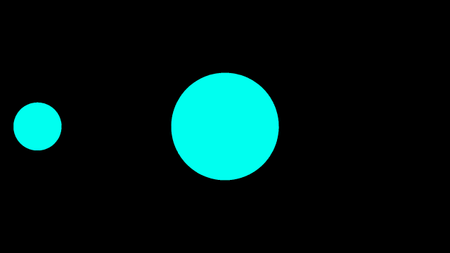

# Gravity

A fullscreen two-dimensional N-body simulator built with Kotlin/JVM and
OpenGL 4.3. Gravity, collisions, integration, and trajectory prediction are
computed by GPU compute shaders.



## Technical model

| Parameter | Default value |
|---|---:|
| Initial body count | `50,000` |
| Maximum capacity | `400,000` |
| FFT grid | `512 × 256` |
| Physics time step | `1/120` |
| Collision substeps | `16` |
| Body contact diameter | `1.12838 px` |
| Gravitational constant | `0.035` |
| Ewald softening radius | `0.85` cells |
| Visual pressure upper bound | `64 px/s` |
| Projectile diameter | `50 px` |

- The simulation domain matches the primary display resolution.
- Space is toroidal by default: the left edge connects to the right edge and
  the top connects to the bottom. Coordinates wrap periodically without
  reflection or velocity changes. Key `B` switches to walls at the screen
  edges and back, without restarting (see [Walls](#walls)).
- Each body's position and velocity are stored in an SSBO as
  `vec4(x, y, vx, vy)` in normalized coordinates. A parallel material buffer
  holds `vec2(mass, friction)`: every body has unit mass except the bodies of
  [rectangular blocks](#rectangular-blocks), and every body has the friction
  coefficient `--friction` (`0` by default).
- Initial positions are uniformly random across the screen and initial
  velocities are zero. The seed is generated with `SecureRandom` and printed
  to the console.
- Bodies are never merged or removed. New bodies are added only by firing
  projectiles, until `--capacity` is reached.
- VSync and multisampling are disabled. Every body is rendered as a single
  `1 px` point on a black background.

### Gravity

The simulator uses a P3M scheme:

1. Mass is deposited onto a periodic grid with CIC.
2. A radix-2 2D FFT transforms the density.
3. A periodic Green's function based on the torus minimum image is applied in
   frequency space.
4. The solver applies double-CIC-window deconvolution and Gaussian Ewald
   splitting.
5. Two inverse FFTs produce the far-field components.
6. The field is interpolated back to bodies with CIC.
7. The short-range force is corrected through linked lists of grid cells.

The local search radius is three times `--softening`, clamped to 1–6 cells on
each axis. Up to two bodies in a neighboring cell are evaluated exactly; a
denser neighboring cell is represented by its mass monopole. No more than
eight bodies are checked in the home cell.

On the torus the FFT grid covers the entire physical domain and does not use
zero-padding. Both dimensions must be powers of two. Twiddle factors are
computed once per simulation; one table serves every transform length. The
spectral kernel is recomputed when the space mode changes.

Gravity is normalized to the number of bodies currently simulated: the total
mass stays the same and is shared by all of them. A projectile therefore
redistributes that mass instead of adding to it, and the kernel is rebuilt
(two forward FFTs) whenever the body count changes. 250,000 bodies attract
each other equally whether they were created with `--bodies=250000` or fired
as projectiles into a 50,000-body start.

### Uniform field and clearing

Each arrow key toggles a uniform gravity field in its direction: the first
press switches it on, the second off. Arrows are independent, so two
perpendicular arrows give a diagonal field and opposite arrows cancel. The
field (`300 px/s²` by default, scaled with the screen height) is added to
every body's acceleration and to the trajectory preview, and survives resets.
The overlay shows it as `Field:`. Combined with walls (`B`), bodies settle on
the chosen floor.

`G` switches gravity between bodies off and on. While it is off, the density
grid, FFT and near-field passes are skipped; collisions, walls and the
uniform field still act, and the trajectory preview follows the field alone.
The overlay shows it as `Gravity:`; the setting survives resets.

`C` starts a fresh session with no active bodies, keeping the space mode and the
field. Physics is idle until a projectile is fired.

### Walls

Key `B` toggles between the torus and a box bounded by the screen edges. The
current mode is shown as `Space:` in the overlay and survives resets and
scenario changes.

- A wall is treated as an immovable body. A body touching it takes the whole
  correction that a pair of bodies would split: the same penetration
  correction, the same restitution coefficient on the approaching normal
  velocity, the same `Δv = Δx/Δt` conversion and the same pressure. A body
  hitting a wall therefore moves exactly like a body hitting its mirror image;
  a GPU test checks this. The wall counts as one extra contact in the Jacobi
  weight, so body pairs keep their symmetric weights.
- Bodies never touch across an edge, positions are clamped instead of
  wrapped, and the trajectory preview stops at walls with the same
  restitution.
- Gravity is isolated: the FFT mesh doubles on both axes and the density
  occupies one quadrant (Hockney zero padding), so nothing attracts across
  the walls. The physical resolution is unchanged; the larger FFT costs about
  1 ms per step at `3440×1440`. Walls need a grid of at most `1024` cells per
  axis.
- Without the periodic background subtraction, a uniformly filled box
  collapses towards its centre as a whole. Scenario orbital speeds assume the
  torus and are slightly off with walls.

### Integration and collisions

- Integration uses symplectic kick-drift-kick.
- One physics step is divided into `--collisions` collision substeps.
- Contacts are found in a separate periodic spatial hash. Cell size is at
  least the contact diameter, and a `3 × 3` neighborhood is searched.
- Collision-cell linked lists are traversed completely; there is no per-cell
  body limit.
- By default, a GPU neighbor cache reuses the broad phase while every body
  stays within a conservative half-skin displacement bound. Actual contacts
  are checked on every substep and passed directly to the solver. Overflow
  uses complete linked-list traversal; fast scenes rebuild the ordinary grid.
  All 16 substeps and the final contact pass are retained.
- Every second step the body arrays are reordered along a Morton curve of
  small screen tiles, so neighbouring bodies have neighbouring IDs and every
  neighbor search reads nearby memory. It is a pure permutation and costs
  about 0.1 ms at 400k bodies.
- Bodies are modeled as circles with a restitution coefficient of `0`.
- A Jacobi correction removes penetration and approaching normal velocity.
  Each body of a pair takes the other's share of the pair mass,
  `m_j / (m_i + m_j)`, so the impulses are equal and opposite and momentum is
  kept; equal masses split a correction in half. Position correction is
  converted to velocity with `Δv = Δx/Δt`.
- Coulomb friction acts on the tangential relative velocity. The pair
  coefficient is `sqrt(μ_i μ_j)`; the tangential change is at most `μ` times
  the normal change of the same pass and never reverses sliding. A wall uses
  the body's own coefficient. With `μ = 0` (the default) the friction code is
  skipped and results are bit for bit those of smooth bodies.
- Gravity weighs every body by its mass: CIC deposit, exact near-field
  sources, and cell monopoles (cell masses are summed in `1/256` units, exact
  for unit masses). Gravity is normalized to the total mass. A uniform field
  accelerates every body alike, so buoyancy comes from collisions alone.
- Pressure is written only by the final collision pass. Body color follows an
  HSV gradient from cyan through green and yellow to red; values above
  `--pressure-max` are clamped to red.
- Optional GPU-adaptive collision substeps use maximum displacement,
  penetration, and contact-graph density. High-speed bodies and dense clusters
  automatically retain the required number of passes.

The primary arrays, FFT buffers, and spatial hashes remain in VRAM. Particle
state is not copied to the CPU every frame. Blocking GPU readback is used only
at the end of explicit diagnostic and benchmark runs.

The average complexity of one physics step is
`O(N + M log M + N·k)`, where `N` is the body count, `M` is the number of FFT
grid nodes, and `k` is the local neighbor count.

### Time scale and pause

The physical `--dt` is always constant. Time scale controls how often complete
physics steps are executed:

- `100%` — one step per rendered frame;
- `50%` — one step every two frames on average;
- `1%` — one step every one hundred frames on average.

The range is `1–100%`, and each mouse-wheel increment changes it by `5%`.
Changing the time scale does not scale velocity, pressure, gravity, or
collision corrections. Pausing skips physics steps and preserves the state
unchanged.

### Projectiles and trajectory prediction

- Keys `1–9` select a diameter of `10–90 px`; key `0` selects `100 px`.
  Key `+` (main row or numpad) selects the smallest diameter holding
  `50000` bodies.
- A projectile is made of hexagonally packed bodies with the same contact
  diameter as every other body. Offset sets are cached separately for each
  selected size.
- Every projectile body receives a velocity of
  `dragVector × 4 px/s` per pixel of mouse movement.
- While the left mouse button is held, the spawn point is shown as a green
  circle with the projectile's actual diameter. Its dash pattern is
  approximately `3 px / 3 px` and continues across torus boundaries.
- Prediction is computed on the GPU from the current gravity field. Collisions
  with moving bodies are not included in the prediction.
- Up to 1,024 adaptive steps are used. The target segment length is `6 px`,
  and prediction time steps are clamped from the physical `dt` through `1 s`.
- The full line length equals the display diagonal. Segments split at torus
  seams while preserving dash phase.
- The minimum dash and gap are `3 px / 3 px`; their lengths increase
  continuously with future normalized speed.
- Opacity changes from 0% at the start to 100% at the end.
- Geometry is recomputed from monotonic time at most 30 times per second and
  rendered every frame from a retained GPU buffer.

### Rectangular blocks

Dragging with the right mouse button outlines a rectangle with a green dashed
frame; releasing it fills the rectangle with hexagonally packed bodies at
rest, with the same contact diameter as every other body. The overlay shows
the future body count as `Block bodies:` while dragging. A block that would
exceed `--capacity` is skipped, like a projectile.

The bodies of a block are glued into one rigid body. Each of them still
collides, feels gravity and the uniform field and hits walls on its own;
after every collision pass the block is projected onto the rigid motion that
best fits its bodies (2D shape matching: centre of mass, best-fit rotation,
and the velocity and angular velocity that keep its momentum and angular
momentum). A hit therefore pushes and spins the whole block, and a block
dropped onto a wall stays a rectangle.

- Members are listed per block and padded to whole 256-body workgroups, so
  every workgroup sums a single block in shared memory: no float atomics, and
  the result does not depend on scheduling.
- Spatial sorting renames bodies; the scatter records every body's new ID and
  the member lists follow it.
- Up to `256` blocks per session; `C`, `R` and scenario changes remove them.
  Without blocks the passes are skipped.
- A GPU test checks that a block hit off centre keeps its shape to `1e-2 px`,
  moves, spins and conserves momentum.

Every body of a block has the mass `--block-density` (`0.5` by default;
`0.05–10`), the other bodies have unit mass. With the field on and walls, a
light block dropped onto a pile floats at its surface and a heavy one sinks
into it; GPU tests check both. Without liquid mode the pile is a granular
solid: equal frictionless discs lock into a hexagonal packing, so a block
finds its level where it lands, as on sand. A light block buried deep in a
pile stays there, and a heavy one stops once the pile below can carry it. In
[liquid mode](#liquid-mode) a light block rises from the bottom and a heavy
one sinks to it.

### Liquid mode

Key `L` (or `--liquid=true`) turns the bodies outside blocks into a liquid.
It is a position-based fluid (Macklin & Müller 2013) solved on the GPU once
per physics step, after the collision substeps:

1. A linked-list grid with cells no smaller than the kernel radius `h`
   (`--liquid-kernel`, `2` contact diameters) is built once per step.
2. `--liquid-iterations` (`4`) Jacobi iterations solve the density
   constraint `C = max(ρ/ρ0 − 1, 0)` of every liquid body, with the 2D poly6
   kernel for density and the spiky kernel for its gradient. The rest density
   `ρ0` is that of the hexagonal packing, so the liquid keeps the spacing of
   ordinary bodies. The constraint only pushes, so a free surface never
   clumps. Corrections become velocity as `Δv = Δx/Δt`.
3. XSPH viscosity (`--liquid-viscosity`, `0.05`) smooths the flow between
   liquid bodies.

- Liquid bodies do not collide with each other as hard discs, so they never
  lock into a packing and flow under any pressure. Every pair with a block
  body, and every wall, stays a hard contact: liquid cannot seep through a
  block however much it is compressed.
- Block bodies count in the density around them and take the reaction of
  the liquid scaled by the mass ratio, so every pair keeps its momentum; the
  rigid projection spreads it over the block. Buoyancy follows: a block of
  `--block-density` below `1` floats, above `1` sinks.
- Every pass searches around the cell a body had when the grid was built,
  so a pair is seen from both sides even when bodies cross cells during the
  iterations. Momentum is kept exactly; a GPU test checks it with a block in
  a violently expanding blob.
- Pressure colours show the compression `C`.
- Physics is cheaper with the liquid on: pairs of liquid bodies skip the hard
  contact count. On the `calm` benchmark (50,000 bodies, `3440×1440`, RTX 2060
  SUPER) a step takes `1.50 ms` with the liquid and `2.13 ms` without it; the
  liquid passes take `0.43 ms`.
- GPU tests: a column collapses into a level pool of the expected depth, a
  light block rises from the bottom, a heavy one sinks, momentum is kept.

### Overlay and console

The upper-left overlay shows:

- FPS, updated every 250 ms;
- current body count;
- body count in a projectile of the selected size;
- time scale as a percentage;
- future projectile speed while the left mouse button is held;
- future block body count while the right mouse button is held.

Controls are shown in the lower-left corner. Both blocks and the scenario
buttons share one UI layer: STB Easy Font text on the same translucent panels. Every two seconds the console reports body count, FPS,
smoothed GPU frame time, and FFT grid size.

### Scenarios

Ten buttons in the top-right corner restart the simulation in a prepared
scenario (at most `200000` bodies each; `R` restarts the current one). Gravity
is normalized to the current body count (see [Gravity](#gravity)). Distances and body counts are
authored for a `1440 px` tall screen; distances scale with its height and
counts with its area (never above the authored counts).

| Scenario | Bodies | Setup |
|---|---|---|
| Turbulent cloud | 140k | Spinning cloud with random eddies; fragments into arms and clumps that merge |
| Spiral galaxy | 200k | Heavy packed bulge and a light disc with seeded arms; winds for many orbits |
| Galaxy collision | ~180k | Two disc galaxies on a long elliptical orbit; tidal tails, then a merger |
| Spinning planet | ~170k | Planet spinning past break-up; the equator sheds spiral streams |
| Planetary impact | ~180k | Grazing giant impact; debris disc around the merged planet |
| Ringed planet | 200k | Heavy planet inside a light ring; the ring winds into spiral wakes |
| Binary stars | 190k | Two stars inside a circumbinary disc; streams, accretion, a final merger |
| Galaxy flyby | ~200k | Two companions sweep past a disc; tidal bridges and tails |
| Planetary system | ~99k | Star, two planets and an asteroid belt stirred into waves |
| Cosmic web | ~200k | Zel'dovich-displaced lattice folding into filaments and halos |

Collisions are perfectly inelastic, so every scenario eventually condenses;
rotation and a dominant central mass are what keep structure alive. Three
rules came out of 60-second runs of every scenario:

- Structures stay within `480 px` of the centre. Beyond about a third of the
  screen height, the periodic images above and below distort discs.
- Free bodies are placed on a jittered hexagonal lattice (spacing `1.3`
  diameters) instead of independently at random. Random starts overlap, and
  the collision solver pushes overlapping pairs apart at hundreds of px/s.
- Discs must be much lighter than the mass they orbit; a self-gravitating
  disc collapses within one orbit.

Orbital speeds use the 2D circular speed `v = H·sqrt(G·f)`, where `f` is the
enclosed mass fraction minus the uniform background removed by the periodic
solver. One physics step takes about 3–10 ms per scenario on a `3440×1440`
screen.

## Controls

| Input | Action |
|---|---|
| Hold and drag LMB | Select projectile direction and speed; show prediction |
| Release LMB | Spawn a projectile at the initial press position |
| Hold and drag RMB | Outline a rectangle between the press point and the cursor |
| Release RMB | Fill the rectangle with bodies glued into one rigid block |
| LMB on a top-right button | Restart in that scenario |
| `1`–`9` | Select a projectile diameter of `10–90 px` |
| `0` | Select a projectile diameter of `100 px` |
| `+` | Select a projectile of `50000` bodies |
| Mouse wheel down/up | Decrease/increase time scale by 5% |
| `P` | Pause or resume without changing state |
| `S` | Set the velocity of every active body to zero |
| `B` | Toggle between the torus and walls at the screen edges |
| `↑` `↓` `←` `→` | Toggle a uniform gravity field in that direction |
| `C` | Remove all bodies; projectiles can be fired into the empty screen |
| `G` | Toggle gravity between bodies; the uniform field and collisions stay |
| `L` | Toggle liquid mode for bodies outside blocks |
| `R` | Create a new GPU session and restart the current scenario |
| `Esc` | Exit |

## Requirements

- 64-bit Windows or Linux.
- JDK 18 installed; the build explicitly uses `jvmToolchain(18)`.
- A GPU and driver supporting OpenGL 4.3 Core, compute shaders, and SSBOs,
  with at least 9 storage buffers per compute shader (the specification
  minimum is 8; current NVIDIA, AMD and Intel drivers allow 16 or more).
- A primary monitor accessible through GLFW. The application opens fullscreen
  on that monitor at its current resolution.
- Internet access on the first Gradle Wrapper run to download Gradle and Maven
  dependencies.
- Enough VRAM for the selected `--capacity` and `--grid`. Increasing either
  parameter increases persistent VRAM usage.

Gradle starts the application with `-Xms512m`, `-Xmx2g`, and `-XX:+UseZGC`.
On Windows, JNA brings the fullscreen window to the foreground. Standard macOS
OpenGL is limited to version 4.1, so the OpenGL 4.3 requirement normally
precludes running on macOS.

## Running

Windows:

```powershell
.\gradlew.bat run
```

Linux:

```bash
./gradlew run
```

Run with options:

```powershell
.\gradlew.bat run --args="--bodies=50000 --capacity=400000 --grid=512x256"
```

Only `--key=value` syntax is supported.

### Body size

`--point-size=S` is the single body-size option, for example
`--args="--point-size=3"`. Every size-dependent default follows it, while
options given explicitly still win:

| Derived default | At point size `S` |
|---|---|
| Contact diameter (`--diameter`) | `1.12838 × S`: a disc with the area of the `S×S` point |
| Neighbor-cache skin (`--collision-skin`) | `0.5 × S` px |
| Initial bodies (`--bodies`) | `50000 / S²` |
| `+` bullet bodies (`--projectile-plus-bodies`) | `50000 / S²` |
| Red pressure (`--pressure-max`) | `64 / S^1.2` (measured cluster pressure scaling) |
| Scenario body counts | scaled by `1 / S²` (capped at the authored counts) |
| Colour smoothing and hole filling | taps and neighbour tests spaced by `S` px |
| Body shape | antialiased disc of the contact diameter (same area as the point) |

Every body is drawn as an antialiased disc of its contact diameter, matching
the circular collisions. Edge pixels store the fraction of the pixel inside
the disc (8×8 subsamples, only for pixels on the edge), and that coverage
sets the brightness. Each body therefore adds exactly its area wherever it
sits: small bodies never vanish between pixel centres or flicker as they
move; at `S = 1` a lone body is a soft dot spread over up to four pixels.
Rendering costs about 0.13 ms more per frame at `S = 1` (200k bodies) and
about 0.02 ms at `S = 3` or `S = 6` compared with square points.

Counts shrink with body area, so clusters, planets, discs and bullets keep
their size on screen with fewer, larger bodies; physics gets faster
accordingly (a galaxy step drops from ~6 ms to ~1 ms at `S = 3`). Gravity is
normalized to the body count, so dynamics are unchanged. The contact diameter
may reach `16 px`.

All runtime tuning is defined in the typed
[`GravityConfig`](src/main/kotlin/dev/gravity/GravityConfig.kt) object. It is
split into `particles`, `gravity`, `collisions`, `trajectory`, `projectiles`,
`presentation`, and `diagnostics` sections. Command-line and environment
values are parsed into the same object, and unknown command-line keys are
rejected. Shader ABI values such as workgroup width, SSBO layouts, shared FFT
capacity, and vertices per trajectory step remain implementation constants
because changing them at runtime would invalidate compiled shader layouts.

| Option | Default | Constraints and purpose |
|---|---:|---|
| `--bodies=N` | `50000 / S²` | Initial body count; clamped to `capacity` |
| `--capacity=N` | `400000` | GPU buffer capacity, `N > 0` |
| `--grid=WxH` | `512x256` | FFT grid; dimensions are powers of two in `128–2048` |
| `--grid=N` | — | Square `N × N` FFT grid |
| `--gravity=F` | `0.035` | Gravitational constant, `F ≥ 0` |
| `--softening=F` | `0.85` | Ewald softening in cells, `F > 0` |
| `--dt=F` | `0.008333...` | Constant physics time step, `F > 0` |
| `--collisions=N` | `16` | Maximum collision substeps, `1–16` |
| `--diameter=F` | `1.12838 × S` | Body contact diameter, `0.5–16 px` |
| `--pressure-max=F` | `64 / S^1.2` | Pressure mapped to red, `F > 0` |
| `--frames=N` | disabled | Exit after `N > 0` frames and print diagnostics |
| `--square-test=W` | disabled | Place one body per pixel in a region of width `W` |
| `--disc-test=R` | disabled | Place the bodies uniformly at random (not packed) in a centred disc of radius `R` px |
| `--seed=N` | random | Reproducible signed 64-bit initial-state seed |
| `--profile=true\|false` | `false` | Detailed asynchronous per-stage GPU profiler |
| `--benchmark=calm\|projectile` | disabled | Reproducible finite benchmark; enables the profiler |
| `--warmup-frames=N` | `120` | Benchmark warm-up frames, `N ≥ 0` |
| `--benchmark-frames=N` | `240` | Measured benchmark frames, `N > 0` |
| `--fft-validate=true\|false` | `false` | Blocking diagnostic GPU FFT comparison with a double reference |
| `--adaptive-collisions=true\|false` | `false` | GPU-adaptive collision substeps; `--collisions` remains the maximum |
| `--collision-cache=true\|false` | `true` | Reuse exact broad-phase candidates and current contacts; no substeps or contacts removed |
| `--collision-skin=F` | `0.5 × S` | Neighbor-cache distance reserve in pixels, `F > 0`; affects search cost only |
| `--sort-interval=N` | `2` | Physics steps between spatial reorderings of the body arrays, `N ≥ 0`; `0` disables it |
| `--collision-neighbor-radius=N` | `1` | Collision-cell search radius, `1–4` |
| `--restitution=F` | `0` | Collision restitution coefficient, `0–1` |
| `--friction=F` | `0` | Coulomb friction coefficient of every body, `F ≥ 0` |
| `--coincident-distance-epsilon=F` | `1e-12` | Squared-distance epsilon for coincident bodies, `F > 0` |
| `--adaptive-displacement-fraction=F` | `0.25` | Allowed displacement as a fraction of body diameter, `0–1` |
| `--adaptive-penetration-fraction=F` | `0.125` | Penetration trigger as a fraction of body diameter, `0–1` |
| `--adaptive-dense-contact-count=N` | `4` | Contacts required for a body to count as dense |
| `--adaptive-dense-body-fraction=F` | `0.01` | Dense-body fraction that selects all collision passes, `0–1` |
| `--adaptive-dense-min-bodies=N` | `256` | Minimum dense-body threshold, `N ≥ 1` |
| `--near-radius-sigma=F` | `3` | Near-field search radius in softening sigmas, `F > 0` |
| `--near-radius-min=N` | `1` | Minimum near-field radius in cells |
| `--near-radius-max=N` | `6` | Maximum near-field radius in cells |
| `--near-exact-bodies=N` | `2` | Neighbor-cell bodies evaluated exactly before using a monopole |
| `--near-home-bodies=N` | `8` | Maximum exact interactions in the home gravity cell |
| `--near-min-distance-fraction=F` | `0.05` | Near-force minimum distance as a cell-size fraction |
| `--cic-window-floor=F` | `0.08` | Minimum squared CIC assignment-window power used in deconvolution |
| `--field-gravity=F` | `300` | Arrow-key uniform field in px/s² at a 1440 px tall screen, `F ≥ 0` |
| `--trajectory-steps=N` | `1024` | Maximum predicted trajectory steps, `1–65536` |
| `--trajectory-max-dt=F` | `1` | Maximum trajectory integration step in seconds |
| `--trajectory-segment-px=F` | `6` | Target predicted segment length in pixels |
| `--trajectory-path-diagonals=F` | `1` | Maximum path length in viewport diagonals |
| `--trajectory-updates-per-second=N` | `30` | Maximum trajectory recomputation frequency |
| `--trajectory-min-dash-px=F` | `3` | Minimum trajectory dash and gap length |
| `--projectile-diameter=F` | `50` | Initially selected projectile diameter |
| `--projectile-drag-scale=F` | `4` | Projectile speed per drag pixel |
| `--projectile-min-drag-px=F` | `2` | Minimum drag distance that creates a projectile |
| `--projectile-size-step=F` | `10` | Diameter increment selected by keys `1–9` |
| `--projectile-max-diameter=F` | `100` | Diameter selected by key `0` |
| `--projectile-plus-bodies=N` | `50000 / S²` | Projectile body count selected by key `+` |
| `--block-density=F` | `0.5` | Mass of each body of an RMB block, `0.05–10`; other bodies have `1` |
| `--liquid=true\|false` | `false` | Start in liquid mode (key `L` toggles it) |
| `--liquid-kernel=F` | `2` | Liquid kernel radius in contact diameters, `1.5–4` |
| `--liquid-iterations=N` | `4` | Liquid density iterations per physics step, `1–16` |
| `--liquid-viscosity=F` | `0.05` | XSPH viscosity per physics step, `0–1` |
| `--preview-period-px=F` | `6` | Projectile-preview dash period |
| `--benchmark-projectile-x=F` | `0.25` | Normalized benchmark projectile X origin |
| `--benchmark-projectile-y=F` | `0.5` | Normalized benchmark projectile Y origin |
| `--benchmark-projectile-diameter=F` | `100` | Benchmark projectile diameter |
| `--benchmark-projectile-vx=F` | `2000` | Benchmark projectile horizontal speed |
| `--benchmark-projectile-vy=F` | `0` | Benchmark projectile vertical speed |
| `--target-gpu-ms=F` | `13.5` | Initial smoothed GPU-time display value |
| `--time-scale-min=F` | `0.01` | Minimum interactive time scale, `0–1` |
| `--time-scale-scroll=F` | `0.05` | Time-scale change per mouse-wheel increment |
| `--fps-update-ms=N` | `250` | Overlay FPS update interval |
| `--console-report-ms=N` | `2000` | Console statistics interval |
| `--gpu-smoothing=F` | `0.08` | Exponential GPU-time smoothing factor, `0–1` |
| `--point-size=S` | `1` | Body size in pixels; scales every size-dependent default (see [Body size](#body-size)) |
| `--overlay-characters=N` | `256` | Maximum overlay character capacity |
| `--overlay-margin-px=F` | `8` | Overlay margin in pixels |
| `--overlay-line-height-px=F` | `12` | Overlay line height in pixels |
| `--profiler-ring=N` | `16` | Asynchronous profiler frame-ring size |
| `--profiler-segments=N` | `128` | Maximum measured stage segments per frame |
| `--profile-history=N` | `8192` | Maximum completed profiles retained in memory |
| `--timer-ring=N` | `16` | Lightweight frame-timer query-ring size |

Environment variables:

| Variable | Equivalent option |
|---|---|
| `GRAVITY_BODIES` | `--bodies` |
| `GRAVITY_CAPACITY` | `--capacity` |
| `GRAVITY_GRID` | `--grid` |
| `GRAVITY_G` | `--gravity` |
| `GRAVITY_SOFTENING` | `--softening` |
| `GRAVITY_DT` | `--dt` |
| `GRAVITY_COLLISIONS` | `--collisions` |
| `GRAVITY_DIAMETER` | `--diameter` |
| `GRAVITY_PRESSURE_MAX` | `--pressure-max` |

A command-line argument takes precedence over its environment variable.
`--frames`, `--square-test`, `--seed`, `--profile`, and benchmark options do
not have environment equivalents.

Reproduce the per-stage baseline with:

```powershell
.\scripts\run-performance-baseline.ps1
```

Run the final matrix with adaptive collision substeps:

```powershell
.\scripts\run-performance-final.ps1
```

Results and quality comparison:
[`docs/performance.md`](docs/performance.md).

The current default cache preserves the fixed substep budget. Its GPU
correctness checks and paired benchmarks run without opening a visible window:

```powershell
.\scripts\run-performance-lossless.ps1
```

See [`docs/performance-neighbor-cache.md`](docs/performance-neighbor-cache.md)
for its guarantees, measured results, and memory cost, and
[`docs/performance-spatial-sort.md`](docs/performance-spatial-sort.md) for the
spatial reordering and leaner collision passes (up to 7.4× faster physics). The older baseline and
adaptive scripts explicitly disable this cache to keep those experiments separate.

The baseline methodology, hardware, and results are documented in
[`docs/performance-baseline.md`](docs/performance-baseline.md).

Diagnostic example for 400,000 bodies:

```powershell
.\gradlew.bat run --args="--bodies=400000 --square-test=632 --frames=2400"
```

`--square-test=W` creates a `W × ceil(bodies/W)` region in the center of the
screen. The region must fit within the current resolution. After the final
frame, the application reports cluster center, covariance area, equivalent
diameter, 90% and 99% core-area estimates, maximum and average speed, and the
number of non-finite bodies.

`--disc-test=R` instead scatters the bodies uniformly at random in a disc of
radius `R` px at the screen centre, at rest. They start apart, and gravity
pulls them into one dense cluster within seconds:

```powershell
.\gradlew.bat run --args="--bodies=250000 --disc-test=650 --seed=20260730"
```

Build a runnable distribution:

```powershell
.\gradlew.bat installDist
.\build\install\gravity\bin\gravity.bat
```

## Dependencies

| Component | Version | Purpose |
|---|---:|---|
| Kotlin JVM Gradle plugin | `2.4.10` | Kotlin/JVM compilation |
| JVM toolchain | `18` | Target Java toolchain |
| Gradle Wrapper | `9.6.1` | Build and dependency management |
| LWJGL BOM and Core | `3.4.1` | Java access to native APIs |
| LWJGL GLFW | `3.4.1` | Window, fullscreen mode, and input |
| LWJGL OpenGL | `3.4.1` | OpenGL 4.3 and compute shaders |
| LWJGL STB | `3.4.1` | STB Easy Font for the overlay |
| LWJGL platform natives | `3.4.1` | Native libraries for the current OS |
| JNA Platform | `5.18.1` | Foreground-window handling on Windows |
| Kotlin Test | Kotlin version | Unit tests |
| JTransforms | `3.2` | Reference FFT used only by tests |

Runtime and test dependencies are downloaded from Maven Central, the Kotlin
plugin comes from the Gradle Plugin Portal, and the Gradle Wrapper distribution
comes from `services.gradle.org`. The LWJGL native package is selected
automatically as `natives-windows`, `natives-linux`, or `natives-macos`.

## Tests

```powershell
.\gradlew.bat test
```

Actual OpenGL collision-shader comparisons (requires an OpenGL 4.3 GPU):

```powershell
.\gradlew.bat gpuTest
```

Tests cover:

- configuration parsing and validation;
- random and pixel-grid initialization;
- radix-2 FFT output against JTransforms;
- periodic coordinates, the collision grid, and fast bodies crossing seams;
- time-scale scheduling and trajectory update frequency;
- projectile dimensions and packing from `10–100 px`;
- the O(N²) CPU collision reference, coincident bodies, dense cells, and
  symmetric Jacobi corrections.
